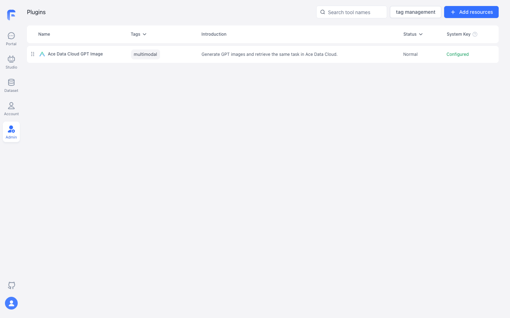
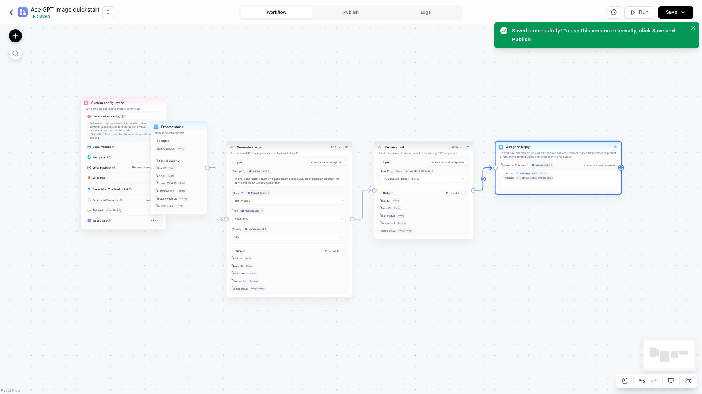
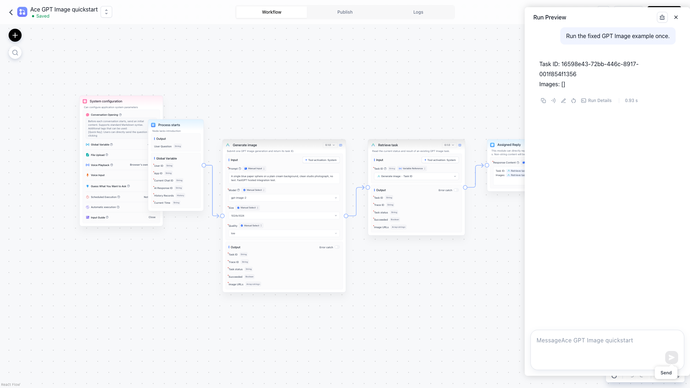
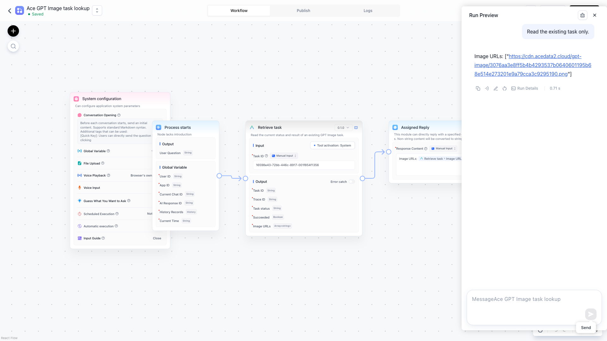

# GPT Image 图像 · Ace Data Cloud for FastGPT

这是 **Ace Data Cloud** 维护的独立 GPT Image 集成，使用你自己的 Ace 应用 API Token；不是 GPT Image 或 FastGPT 官方插件。

[English guide](README.md) · [API 与价格](https://platform.acedata.cloud/models?utm_source=opensource&utm_medium=referral&utm_campaign=evergreen&utm_content=gptimagefastgpt_readme_pricing)

本插件把**生成图像**、**编辑图像**与单项／批量任务查询分开。生成只提交一次；后续只查询原任务 ID。异步返回任务 ID 或工作流显示成功，都不代表图片已生成。

## 从零开始

[FastGPT 官方插件市场](https://cloud.fastgpt.io/config/tool/marketplace) · [本插件官方收录审核](https://github.com/labring/fastgpt-community-plugins/pull/71)。当前候选尚未上架，审核链接不是安装按钮。

新用户先注册并登录 Ace；Applications 中若没有 General application，先点 **Initialize General Application**。这里创建的是 Ace API Token，不是 FastGPT 登录凭据。

1. 使用 FastGPT 4.15 或更新版本。当前尚未官方上架；批准后按服务名搜索并核对作者 **Ace Data Cloud**。现有安装包与校验文件在 [GitHub 正式版本](https://github.com/AceDataCloud/GPTImageFastGPT/releases/tag/v0.2.2)。系统管理员可在插件管理上传；**团队管理员或所有者**在系统已开启“团队上传插件”时，也可从 **工具 → 添加插件 → 上传插件** 上传 .pkg，并在解析后确认安装。该开关也控制团队 Marketplace 安装，普通成员不能安装。团队与系统插件密钥独立。

   依据为 [FastGPT 当前团队安装文档](https://github.com/labring/FastGPT/blob/main/document/content/plugin/team-installation.mdx)，读取日期2026-10-19。具体Cloud工作区能否使用，需核当前版本、套餐/功能开关和现有角色；缺按钮不等于需要另注册账号，应先问现有管理员。团队/本地上传不代表官方市场公开收录。

   [官方维护者新反馈](https://github.com/labring/FastGPT/pull/8017#issuecomment-6257574098)要求第三方提供商先单独申请合作。GitHub包公开不代表该准入已批准。
2. 登录 [Ace Data Cloud 应用管理](https://platform.acedata.cloud/console/applications?utm_source=opensource&utm_medium=referral&utm_campaign=evergreen&utm_content=gptimagefastgpt_readme_api_key)，打开 **General Application**。确认已开通 OpenAI generation、余额足够，并查看当期价格。直接复制 API Key；如果要单独创建 FastGPT 密钥，点击 **Manage Keys → Create**。开启 Allowed APIs 时同时允许 /openai/images/generations 与 /openai/tasks。使用 **Edit GPT Image image** 时，还须允许 /openai/images/edits。

创建专用 Token 时点 **Manage Keys → Create**，名称可填 `FastGPT GPT Image`，按需设置有效期与 Allowed APIs，再创建并复制。允许上文的创建和任务查询接口。

此图复用 [Suno Dify 源教程](https://github.com/AceDataCloud/SunoDify/blob/8d3d03570e73324220f111f7fe343da0792a8071/README.md) 的真实 Ace Console 截图（2026-10-08/09）。图中 `Dify tutorial` 是示例名称；请改用自己的 FastGPT 名称，图中没有真实密钥。

3. 在 FastGPT 的插件配置中，将密钥填入 **Ace Data Cloud API key**。只填令牌本身，不加 Bearer、引号或空格。不要放进提示词或工作流导出。
4. 在 **Studio → Create Agent → Workflow** 新建工作流。从 **System Tools** 添加 **GPT Image by Ace Data Cloud / Generate GPT Image** 和 **Retrieve GPT Image task**，激活两个工具并选择已配置的 **System secret**。连接 **Process starts → Generate GPT Image → Retrieve GPT Image task → Basic / Assigned Reply**。生成工具填写 examples/generate.json 中的五项（Image count 保持 1）。查询工具的 **Task ID** 选择 **Variable Reference → Generate GPT Image → Task ID**，不要手动输入节点名称。
5. 在 **Assigned Reply** 中用变量选择器插入查询工具的 **status、success、taskId、mediaUrls**。选择 **Save Only**，再用 **Run Preview** 执行一次。若 status 是 pending，保存 taskId；之后新建 **Process starts → Retrieve GPT Image task → Basic / Assigned Reply** 工作流，只填同一个 Task ID 查询，直到 status=succeeded 且 success=true，再打开 mediaUrls 中的图片。不要重跑生成工作流来轮询。
6. 到 Ace Data Cloud 控制台核对该 taskId 对应的一次调用和 Credits 扣费。Credits 与 USD 的换算以当前套餐价格为准。

本机 FastGPT 仅新提交**一个 GPT Image 任务**。首次预览返回待完成的 Task ID；之后通过独立查询工作流使用同一 ID，取得已完成的图片。

编辑时选择 **Edit GPT Image image**，填入一张经授权且可访问的 HTTPS 参考图片 URL。编辑会单独提交并可能计费；把返回的 Task ID 接到同一个 **Retrieve GPT Image task** 查询工具。

多个已有任务可用 **Retrieve GPT Image tasks** 输入 1–20 个 Task ID，一次只读查询。逐项检查状态；只有全部成功时批次才算成功。此工具不会提交新生成。

如果有请求的任务未返回，或返回的任务 ID 无法对应，批量结果会保持待完成。请核对已有任务 ID，不要重新提交生成。

## 本地可复制的无密钥示例

examples/generate.json 不含密钥。把真实密钥写在本地的 .secrets.local.json，内容为 {"apiKey":"YOUR_OWN_KEY"}，然后运行：

~~~sh
pnpm install
pnpm exec fastgpt-plugin debug . --run --tool generateImage --input-file examples/generate.json --secrets-file .secrets.local.json
pnpm exec fastgpt-plugin build --entry . --output ./dist
pnpm exec fastgpt-plugin check --entry . --output ./dist
pnpm exec fastgpt-plugin pack --entry . --dist ./dist --output ./out
~~~

若返回 pending，复制 taskId，另建不含密钥的 examples/retrieve.local.json（内容为 {"taskId":"返回的任务 ID"}），只运行：

~~~sh
pnpm exec fastgpt-plugin debug . --run --tool retrieveTask --input-file examples/retrieve.local.json --secrets-file .secrets.local.json
~~~

本地密钥文件已被 .gitignore 排除。不要将它提交或截图。

| 情况 | 处理 |
|---|---|
| 401 / 403 | 检查令牌完整性、有效期、服务权限、Allowed APIs 和余额。 |
| 400 | 使用示例模型、尺寸、质量和单张图片；核对实际报错参数。 |
| pending / 无图片 | 只查询相同 taskId，稍后再看。 |
| 429 | 降低并发，等待额度恢复，不自动重试付费生成。 |
| 超时 / 5xx / 任务失败 | 先查原任务与请求记录，再决定是否重新提交；给客服 taskId 或 traceId，不给密钥。 |

插件仅向 api.acedata.cloud 发送所选输入及令牌。图片生成按 [当前服务价格](https://platform.acedata.cloud/models?utm_source=opensource&utm_medium=referral&utm_campaign=evergreen&utm_content=gptimagefastgpt_readme_pricing) 计费。[源码与问题反馈](https://github.com/AceDataCloud/GPTImageFastGPT)。

## 截图范围

FastGPT 截图为 2026-10-09 的自建 4.15.8 实例，显示旧名称和0.1.0插件。它们不证明本次0.2.2新名称、普通市场安装或当前版本真实调用。
